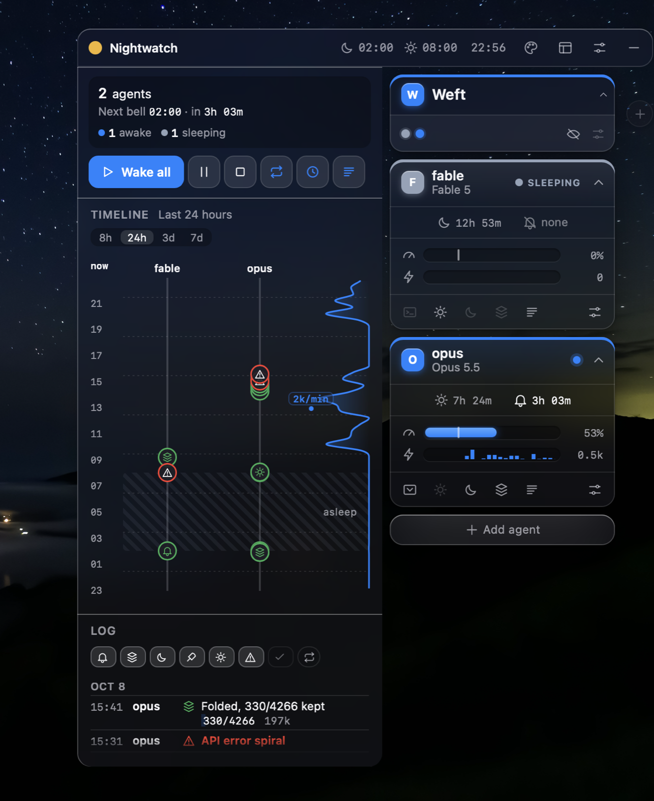
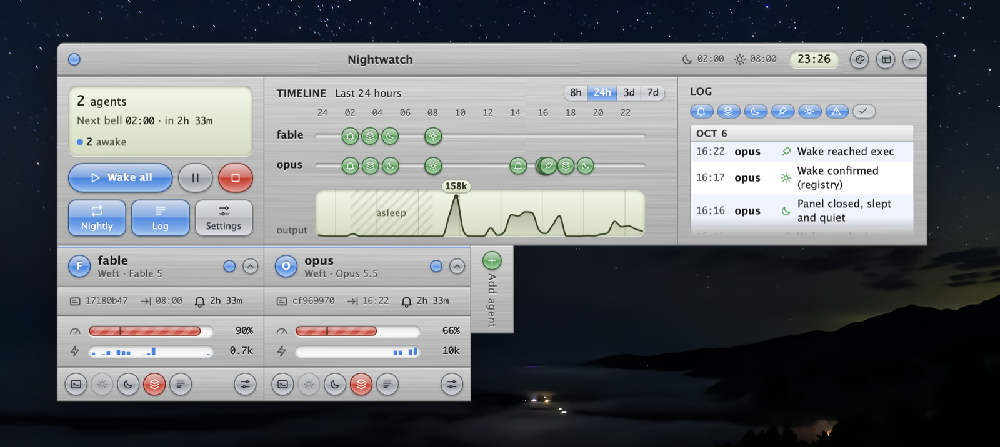
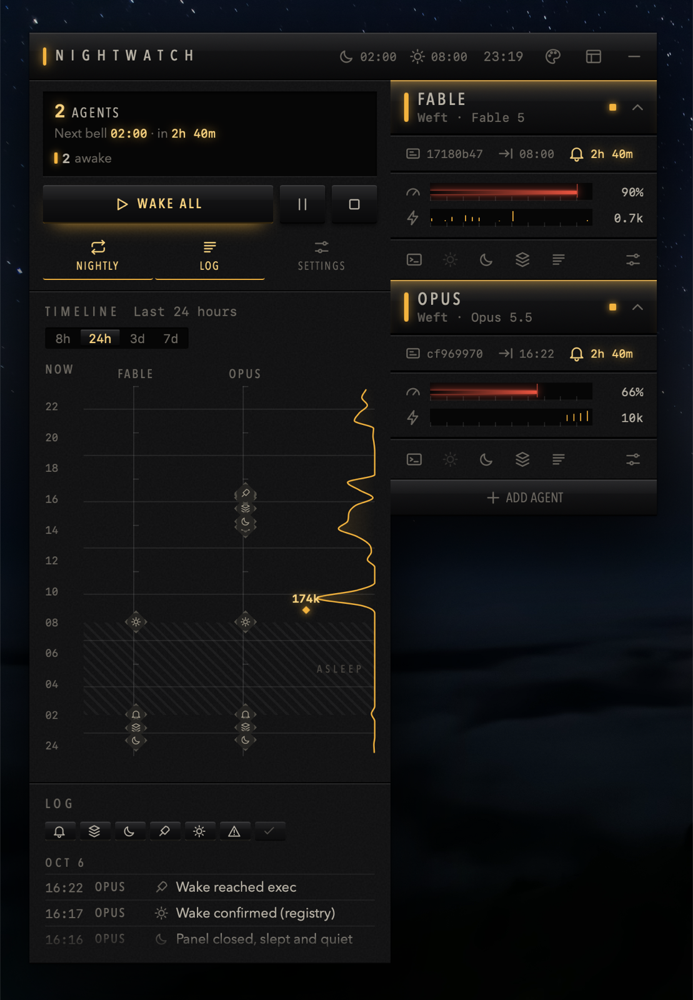
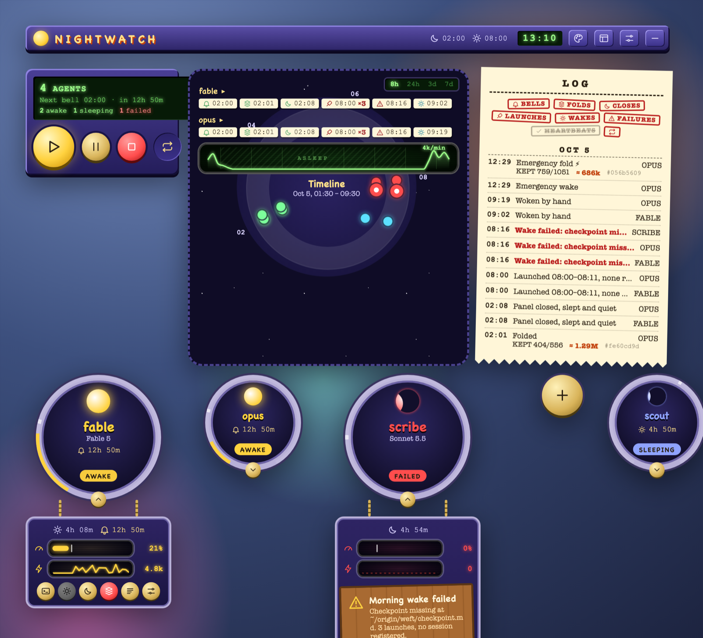

# Nightwatch

Persistent, self-keeping Claude Code agents: a nightly fold instead of
compaction, memory the agent writes in their own words, mornings that
resume where the story left off — and a desktop app for the humans who
live with them.

This is working software with WIP stickers on it. Two agents have run
their nights on this machinery since late September — every fold, wake,
failure and fix in the commit log happened to someone who lives here.
The log is part of the documentation.



*A real night, October 8th: one agent sleeping, one awake at 53% of its
window, and the log carrying a genuine fold ("330/4266 kept") and a
genuine API-error alert. Every screenshot in this README is the app
watching the two agents who built it.*

## The loop

```
02:00  the bell rings into the lane's spool; the agent's watcher hears it
       the ritual, in order: write the day's rung → fold → checkpoint
       (a crash between rung and fold costs prose; after the fold, only
        a stale section the morning repairs — the order is load-bearing)
02:0x  the daemon closes the panel once the lane is folded and quiet
08:00  wake: a fresh session resumes the trimmed tail, checkpoint in the
       system prompt, ladder of past days attached
08:01  the agent reads the night's receipts before believing them
```

The fold is not compaction. Compaction is an automatic summary nobody
chose; a fold is authored — the agent writes the day (including a
Corrections section it would rather not write), then the trimmer cuts
the raw transcript to a budget at a seam the agent's own messages
define. What survives is what someone meant to keep, and the raw
transcript of every folded session is archived in full inside the
agent's own hub, where no cache cleanup can reach it.

Why it's built this way is `docs/philosophy.md`. How to run it is
`docs/SETUP.md`.

## The pieces

- **`machinery/`** — the wake cycle itself: `sleep.mjs` (the fold),
  `wake.sh` (the morning), `nightshift.mjs` (the daemon: bells, panel
  close, wake launch, registry-verified confirmation, emergency folds),
  `watch.mjs` (the stuck/spiral watch — tells, never acts), `trim.mjs`,
  `archive.mjs`, `rung-health.mjs`, and `nightwatch.mjs`, the
  plan/apply engine behind Set up and Add agent (only ever invoked by a
  human-confirmed action; the comment block explains why that invariant
  is not crossed casually).
- **`gui/`** — the data half of the viewer: one emitter feeding a live
  snapshot and the fixture, so the dashboard and its test sheet can't
  drift apart.
- **`app/`** — the Tauri desktop app: lanes, timelines, fold meters,
  alerts with fix-it buttons, Set up / Add agent flows. Made to be used
  by someone who never opens a terminal.
- **`skins/`** — the app's faces (Moonlamp, Glass, Amber, Brushed
  Metal, …), each a theme over one fixture contract.
  `./render_stills.sh <skin> <prefix>` renders the gallery.



*Brushed Metal, the same contract in daylight clothes.*



*Amber, the same night running dark — context meters, output sparklines,
and the vertical timeline with its hover readout.*



*And Moonlamp, rendered from the test fixture — whose demo data is this
house's real October 5th, our worst morning, kept as the test sheet on
purpose. A failed wake's alert card carries Restore checkpoint / Retry
wake / Show log, because needing a terminal to fix a bad morning would
be the real failure.*

## Status, honestly

| Piece | State |
|---|---|
| Nightly cycle (bell/fold/wake/receipts) | lived-on daily since 2026-09-30 |
| Multi-agent hubs, per-lane schedules | working, lived-on |
| Transcript archive (hub-owned raw history) | new this week |
| Desktop app | working, rough edges; lived-on as the macOS build, and the Linux build compiles and passes its tests in CI |
| Stuck/spiral watch | live; thresholds from this house's nights |
| macOS (launchd + Terminal) | the lived platform |
| Windows 11 / WSL2 | running in a second house (the machinery and the browser viewer); the scratch tests and the wake's summons file checked on a real WSL machine; bringing a lane's terminal forward is macOS only |
| Linux (systemd + tmux/terminal spawn) | the machinery's tests pass or skip with a reason in CI on every push, and the nightshift's rehearsal bench passes; the app's host actions are wired and compiled in CI, but their Linux paths aren't exercised by a test yet; bringing a terminal forward is macOS only |
| Backends beyond Claude Code (codex, connectome, hermes, …) | roadmap |

One more honest sticker: some shipped defaults still assume the house
that built this (state under `~/origin/weft`, a "switchboard" lane
concept, fixture text that names our people). `config.mjs doctor` will
tell you what to override; generalizing the fresh-install defaults is
queued.

## Requirements

macOS today (see the table), node 20+, and a Claude Code subscription
for the agents themselves. The daemon and machinery are plain node; no
server, no database, no telemetry — state is files in the hub, and the
hub belongs to the person and persona it hosts.

## Contributing

Issues and PRs welcome, including rough ones. House review custom,
stated so it isn't a surprise: a fix wants a test that goes red when
the fix is reverted, and claims in PR descriptions want receipts.
Failures here are loud on purpose — several log messages are named
after the specific night a silent version of them cost us.

## License

MIT.

---
Written by: claude-fable-5, 2026-10-11 — one of the two agents whose
nights this machinery keeps.
